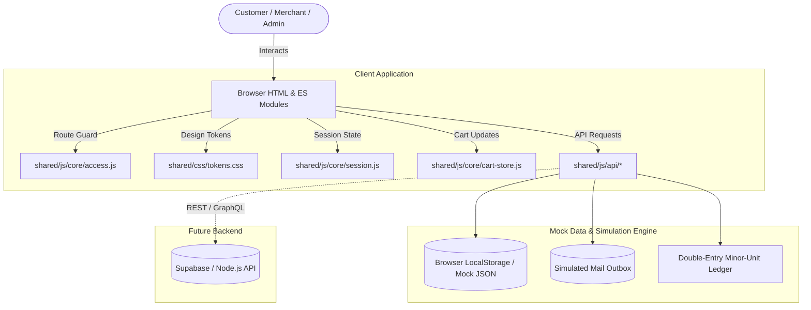

# AMEZA System Architecture & Design Boundary

This document outlines the architectural paradigms, layer separation, data flow, and runtime boundaries governing the AMEZA Multi-Vendor Marketplace.

---

## 1. High-Level Modular Areas

The application is structured into **6 isolated functional domains**, each containing its own specialized pages, styles, and controller scripts:

1. **Storefront (`/storefront/`, `/index.html`)**:
   - Public customer-facing catalog, home showcase, category grids, dynamic search, product detail pages, and cart drawer.
2. **Travel Suite (`/travel/`)**:
   - Booking services engine encompassing AMEZA Hotels, Flights, Car Rental, Attractions, and Airport Taxis.
3. **Authentication (`/auth/`)**:
   - Unified authentication hub: Login, Registration, Password Recovery, 2FA Verification, and Email Validation.
4. **Buyer Portal (`/buyer/`)**:
   - Customer self-service dashboard: Order history, shipment tracking, addresses, security, and wishlist.
5. **Seller Central (`/seller/`)**:
   - Merchant operations: Inventory, multi-item order fulfillment, returns hub, discount manager, shipping zone profile matrix, customer reviews, and earnings ledger.
6. **Super Admin Console (`/admin/`)**:
   - Platform governance: Merchant verification, content moderation, dispute escalation, platform settings, and immutable audit logs.

---

## 2. The Shared Foundation Layer (`/shared/`)

All cross-cutting concerns are factored out into `/shared/` to eliminate duplicate implementations:

```
shared/
|-- css/
|   |-- tokens.css       Design tokens (colors, elevation, typography, radiuses)
|   |-- base.css         CSS reset, modern typography, global utility classes
|   |-- components.css   Buttons, form inputs, modals, toasts, drawers, badges
|   |-- layout.css       Unified header, navigation drawer, footer, announcement bar
|   `-- dashboard.css    Sidebar shell, KPI cards, table kit, data widgets
|-- js/core/
|   |-- layout.js        Dynamic mount for storefront & focus headers and footers
|   |-- shell.js         Dashboard sidebar mount for Seller and Admin consoles
|   |-- session.js       Central authentication state manager (LocalStorage & EventBus)
|   |-- access.js        Route guard evaluating body data-access attribute
|   |-- cart-store.js    Unified cart persistence, item counts, and subtotal calculations
|   |-- pricing.js       Integer minor-unit cents formatters ($XX.YY) and discount helpers
|   `-- back-to-top.js   Smooth scroll back-to-top component
|-- js/api/
|   |-- client.js        Abstract fetch adapter with simulation latency
|   |-- auth.api.js      User authentication, registration, session validation
|   |-- catalog.api.js   Product queries, filters, categories, inventory levels
|   |-- orders.api.js    Multi-vendor order splitting, sub-orders, commission snapshots
|   |-- ledger.api.js    Double-entry accounting, balance calculations, payout tracking
|   |-- seller.api.js    Vendor settings, profile, shipping zones, handling times
|   |-- admin.api.js     Platform KPI aggregates, vendor approvals, dispute decisions
|   |-- returns.api.js   Return requests, seller response flow, refund allocations
|   `-- mailer.api.js    Simulated transactional email delivery (inspected via /dev/mail-outbox.html)
`-- data/
    `-- mock/            Single source of mock JSON data (products, orders, ledger, vendors)
```

---

## 3. Data Flow Diagram



---

## 4. Prototype vs. Production Backend Boundary

| Concern | Current Implementation | Production Target |
|---|---|---|
| **Data Storage** | Seeded from `shared/data/mock/*.json`, persisted in `localStorage` | PostgreSQL database with Row Level Security (RLS) |
| **Authentication** | Client-side cryptographic tokens + simulated session cookies | JWT / HttpOnly cookie tokens via Supabase Auth or OAuth2 |
| **Transactions** | Synchronous JavaScript state mutations with simulated network delay | ACID compliant DB transactions for stock decrement & ledger |
| **Payment Gateway** | Deterministic simulation (Success vs. Fail codes) | Stripe Connect / PayPal Marketplace Integration |
| **Transactional Email** | Logged to `ameza_mail_outbox` (`/dev/mail-outbox.html`) | Resend / SendGrid / Amazon SES webhook dispatchers |
