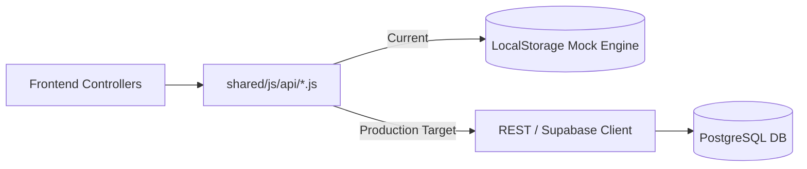

# AMEZA Backend Migration & Implementation Roadmap

This document outlines the step-by-step checklist for replacing the mock simulation layer with a real persistent backend (Node.js/Express or Supabase).

---

## 1. Migration Architecture Strategy

The clean interface boundaries in `shared/js/api/*.js` allow swapping the underlying data source without modifying frontend UI components or HTML files.

---

## 2. API Module Migration Checklist

| Module | Current Engine | Target Implementation | Priority | Status |
|---|---|---|---|---|
| `auth.api.js` | Simulated JWT in `localStorage` | Supabase Auth or `bcrypt` + `jsonwebtoken` HTTP-only cookies | High | Ready |
| `catalog.api.js` | `products.json` filter operations | PostgreSQL table `products` with Full-Text Search indexing | High | Ready |
| `orders.api.js` | Local storage split order creation | PostgreSQL `orders` and `sub_orders` with atomic transactions | High | Ready |
| `ledger.api.js` | In-memory balance aggregator | Double-entry ledger table `ledger_entries` with SQL balance sum | High | Ready |
| `returns.api.js` | `returns.json` array state updates | S3 presigned image uploads + `return_requests` table | Medium | Ready |
| `seller.api.js` | Vendor settings in storage | `vendors` and `shipping_profiles` tables | Medium | Ready |
| `admin.api.js` | Client-side metrics calculation | SQL aggregate views (`SUM(grand_total)`, `COUNT(*)`) | Medium | Ready |
| `mailer.api.js` | Outbox storage array in browser | Resend / SendGrid transactional API dispatch | Low | Ready |

---

## 3. Database Schema Migration Script (`db/`)

The SQL migrations in `db/migrations/` correspond to the exact minor-unit schema defined in [docs/DATA_MODEL.md](DATA_MODEL.md):

1. `001_create_tenants_and_vendors.sql`
2. `002_create_products_and_inventory.sql`
3. `003_create_orders_and_sub_orders.sql`
4. `004_create_double_entry_ledger.sql`
5. `005_create_returns_and_disputes.sql`
